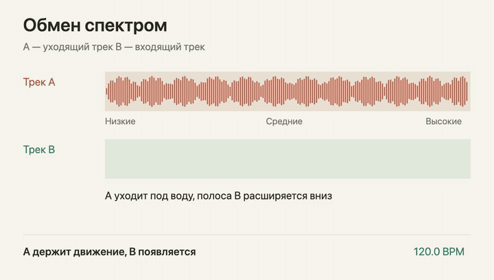
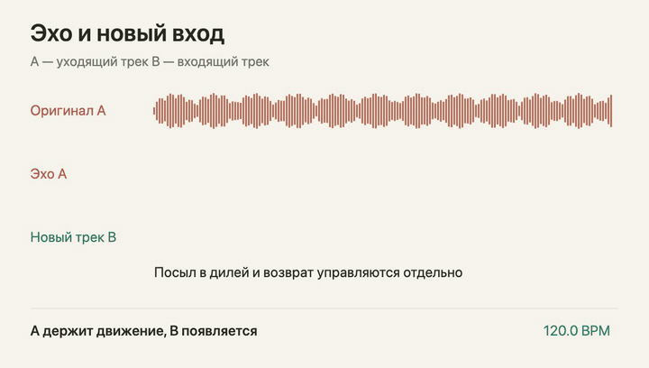
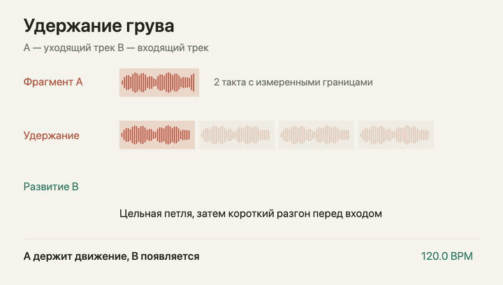

[Сайт с анимациями](https://deepback.github.io/ladio/) / [Спецификация](docs/specification/ENGINE.md) / [Интеграция](docs/INTEGRATION.md) / [Скачать SDK](https://github.com/deepback/ladio/releases/tag/v1.0.0) / [English](README.en.md)

## Зачем мы делаем LADIO

В первых версиях AutoMix у нас уже были фильтры, эхо и повторители. Но часто всё равно получалось: один трек затихает, другой начинается. Эффект присутствует, а музыкального развития между ними нет.

LADIO вырос из попытки решить именно эту проблему. Найти в двух песнях материал, который интересно звучит вместе. Дать новой мелодии появиться под старым ритмом. Закончить фразу, передать бас и раскрыть следующий трек вовремя.

Референс — слушательский опыт AutoMix в Apple Music. **LADIO — независимый движок со своим планировщиком и DSP.** Приватные Apple-фреймворки, AU-пресеты и веса Apple в открытый SDK не входят. Точное совпадение звучания с Apple Music не заявляется.

## Посмотреть, как устроен переход

### Обмен спектром

A постепенно теряет высокие частоты. B входит узкой полосой и расширяется вниз. К выбранной сильной доле новый трек получает полный диапазон. Частотные огибающие работают отдельно от громкости.



### Эхо и новый вход

Сухой A уходит, но короткий мотив продолжает отвечать через дилей. У посыла и возврата разные огибающие: хвост может звучать после завершения оригинала, постепенно освобождая пространство для B.



### Удержание грува

Полезный инструментальный фрагмент A повторяется, пока B развивается. Короткий разгон возможен перед входом. Луп заканчивается в назначенной точке; основной B продолжает движение без возврата к старой позиции.



Это **схематические анимации**, а не запись аудиорендера. Время сжато. Исходники доступны в [Remotion-проекте](visuals/README.md). На [сайте](https://deepback.github.io/ladio/#transitions) можно переключать сцены и останавливать анимацию.

Для звука подготовлены отдельные места: исходные фрагменты, обычное наложение и LADIO на одной паре. Коммерческие треки в репозиторий не загружены. [Как опубликовать аудиопример](docs/AUDIO_EXAMPLES.md).

## Как это работает


**Анализ.** Beat This `small0` оценивает доли и сильные доли. Нативный C++-анализ добавляет энергию, спектральные изменения, гармонию и структурные признаки. Ограниченные области входа и выхода переиспользуют подходящие результаты из кэша.

**Планирование.** Движок ищет фразы, проверяет материал для подведения к B, полезность лупа, совместимость темпа, конфликт гармонии и стоимость подготовки. В плане остаются выбранные точки, временные карты и причины отказа от других сцен. При одинаковых данных, политике и seed выбор воспроизводим.

**Исполнение.** Общая временная карта управляет дорожками, независимыми клипами и обработкой. Signalsmith Stretch меняет длительность с сохранением высоты тона. Наш DSP исполняет фильтры, EQ, темповый дилей, реверберацию, фланжер и ритмический гейт. Тяжёлая подготовка идёт в рабочем потоке; аудиопоток получает готовые блоки.


Вход B, совместная игра, передача баса, раскрытие, последний элемент A и восстановление обычного воспроизведения — **разные события**. Тизер не двигает основную позицию B. Луп имеет явный выход. Хвост эффекта не обязан исчезать вместе с сухой дорожкой.

## Каталог сцен

В версии 1.0.0 — **17 автоматических DJ-сцен и 8 вариантов непрерывного или ручного сведения**. Предпочтительные длины творческих сцен — от 2 до 18 тактов. Планировщик адаптирует их под доступный материал.

Есть обмен спектром, расширение полосы, сведение фраз, подведение к сильному входу, эхо мотива, пространственный мост, удержание грува, повторитель, освобождение гармонии и смена пульса. [Полный каталог](docs/specification/TRANSITIONS.md) связывает каждый сценарий с длительностью и обработкой. Машинный источник — `ladio catalog`.

Наличие сцены в каталоге не означает, что она подходит любой паре треков.

## Темп и вычисления


Совместимые источники следуют одному пульсу. B может войти в темпе A и плавно прийти к своей исходной скорости. Независимые клипы участвуют в той же временной карте. Для несовместимого пульса предусмотрен музыкальный мост вместо чрезмерного непрерывного растяжения.

Автоматический путь работает со стерео: **без Whisper и обязательного разделения на стемы**. Предоставленные окна стемов поддерживаются форматом ресурсов, но готовый разделитель в публичную сборку не включён.

В комплекте одна модель: **Beat This small0, FP32 ONNX, 9,55 МБ**. Она обучена авторами Beat This; LADIO предоставляет экспорт и нативную интеграцию. Веса и код модели опубликованы авторами под MIT. Мел-фронтенд, метаданные и контрольные суммы входят в комплект. [Карточка модели](models/beat-this-small0/MODEL_CARD.md).

## Собрать и попробовать

Нужны 64-битная нативная платформа, C++20, CMake 3.22+ и Python 3.9+ для проверки ресурсов. Ядру ONNX Runtime не требуется.

```sh
git clone https://github.com/deepback/ladio.git
cd ladio
python3 scripts/verify_release.py
cmake -S . -B build -DCMAKE_BUILD_TYPE=Release
cmake --build build --config Release --parallel 2
ctest --test-dir build -C Release --output-on-failure
```

Оригинальный синтетический пример с известной разметкой:

```sh
python3 examples/generate_fixture.py build/demo
build/ladio prepare build/demo/library.json build/demo/mix dj 42
build/ladio render build/demo/mix/session.json build/demo/mix.wav build/demo/report.json
```

На Visual Studio CLI находится в `build/Release/ladio.exe`. Синтетический пример проверяет путь от плана до рендера, а не точность нейросети на реальной музыке.

Для нейросетевого анализа установите ONNX Runtime C/C++ SDK под свою платформу:

```sh
cmake -S . -B build/onnx -DCMAKE_BUILD_TYPE=Release \
  -DLADIO_BUILD_ONNX=ON -DLADIO_ONNXRUNTIME_ROOT=/path/to/onnxruntime-sdk
cmake --build build/onnx --config Release --parallel 2
build/onnx/src/analysis/onnx/ladio_analyze analyze song.f32 models song.json full
```

Вход анализатора — стерео PCM float32 little-endian, 44,1 кГц, 20 секунд–6 минут. Вместо `full` доступны ограниченные области `entry` и `exit`. Декодирование выполняет приложение.

## Встроить в приложение

```cmake
find_package(Ladio 1 CONFIG REQUIRED)
target_link_libraries(my_player PRIVATE Ladio::Core)
```

Граница интеграции — [C ABI](include/ladio/ladio.h). Есть примеры для [C](examples/c), [Python](examples/python), [Swift](examples/swift) и [Android NDK](examples/android). [Руководство](docs/INTEGRATION.md) описывает подготовку, потоки, буферы и зависимости.

В [релизе 1.0.0](https://github.com/deepback/ladio/releases/tag/v1.0.0) — исходники, модель и пакеты ядра для macOS arm64, iOS arm64 и Android arm64. Дополнительный ONNX-анализатор собирается отдельно. Это SDK; декодирование, аудиоустройство, разрешения и работа приложения в фоне остаются у плеера. Браузерный SDK и WebAssembly в эту версию не входят.

## Что подтверждено

Локально пройдены 7 из 7 проверок ядра. Собраны macOS-ядро и ONNX-анализатор, выполнена кросс-компиляция для Android и iOS. Проверены отдельные C-потребители установленного пакета, Python-граница и типизация Swift-примера. Есть сквозной синтетический рендер и анализ реального аудио. [Полная запись проверок](docs/VALIDATION.md).

Неоднозначная ритмическая сетка, точные окончания вокальных слов, субъективное качество на новых песнях и расход энергии на телефонах остаются предметом оценки. В публичном анализаторе нет отдельной обученной модели структуры или инструментальной активности. Гарантии идеального сведения, времени подготовки на любом устройстве и совпадения с Apple Music не заявляются.

## Лицензия и авторство

Оригинальный код, документация, символ LADIO и иллюстрации — **[MIT](LICENSE)**, включая коммерческое встраивание. Зависимости сохраняют свои лицензии. В дополнительном ONNX-пути SoXR подключается отдельной библиотекой под LGPL-2.1-or-later; полный исходный код включён. ONNX Runtime поставляется отдельно. [Все уведомления](THIRD_PARTY_NOTICES.md).

Слово LADIO набрано SF Pro с весом 760 там, где этот системный шрифт установлен. Файлы шрифтов не распространяются. Проект не связан с Apple или OpenAI.

Автор — [Игорь Сахаров](https://github.com/deepback). [Как участвовать](CONTRIBUTING.md). [Источники и границы исследования](docs/REFERENCES.md).
