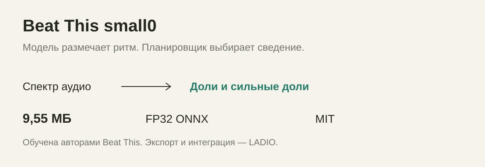

<p align="center"></p>

<p align="center"><a href="docs/VALIDATION.md"></a>   </p>

<p align="center"><a href="README.ru.md">Русский</a> · <a href="https://deepback.github.io/ladio/">Visual paper</a> · <a href="docs/specification/ENGINE.md">Engine specification</a> · <a href="docs/INTEGRATION.md">Embed LADIO</a> · <a href="models/beat-this-small0/MODEL_CARD.md">Model card</a></p>

## A transition is a piece of music

LADIO is an embeddable engine that analyzes musical timing, chooses a transition scene and compiles it into reproducible audio. It grew out of an AutoMix prototype for desktop and mobile listening. Apple Music AutoMix is the product reference: the ambition is to make the space between songs feel composed.

The engine makes **entry, joint play, foundation exchange, arrival, outgoing release and native playback recovery** separate musical events. A new song can enter through a filtered texture, an independent teaser or a complete phrase; the old song can leave a bounded echo or room tail after its dry signal has gone.

This is an independent implementation. It does not contain Apple frameworks, private AU presets or Apple model weights, and does not claim sonic equivalence to Apple Music.

## Observe → compose → perform


**Observe.** Optional Beat This `small0` ONNX inference estimates beats and downbeats. Native C++ descriptors measure local energy, spectral changes, harmony and rhythm. Entry/exit scopes reuse matching cached chunks.

**Compose.** The planner searches measured phrases, evaluates incoming runway and outgoing continuity, considers scene families, tempo compatibility, harmonic conflict, loop usefulness and preparation cost. Selection is deterministic for the same analysis, policy and seed. Unusable candidates carry rejection diagnostics.

**Perform.** One scene clock drives sources, captures, automation and tempo maps. Signalsmith Stretch changes duration while preserving pitch. Native DSP supplies spectral sweeps, tempo delay, room/reverb, flanging, rhythmic gating and independent effect returns. A worker prepares audio; the audio callback consumes a bounded ring buffer.

### What makes this approach useful

- **Events before effects.** The incoming arrival is an anchor, not the accidental end of a fade.
- **One tempo map across the scene.** Independent clips remain tied to the musical clock; B reaches its native rate at the planned arrival or recovery.
- **Stereo first.** The public automatic path does not run a separator or transcription model. Supplied stem windows can be represented by the underlying resource format; they are not a prerequisite for every transition.
- **Readable decisions.** Plans preserve chosen style, cues, timing, loop/capture material and reasons for rejected alternatives.
- **Shared execution.** Prepared playback and offline rendering use the same core, rather than two unrelated implementations.

These are engineering choices, not claims of a new state-of-the-art beat tracker or guaranteed subjective quality.

## The scene, in time


The release contains **17 automatic DJ styles**, plus **8 continuity/manual styles**. Preferred creative lengths range from 2 to 18 bars; the planner adapts duration to available material. Echo/filter, spectral exchange, expanding bands, phrase exchange, groove holds, build/repeat, harmonic blur, room release and pulse-change scenes have different material and effect requirements.

Run `ladio catalog` for the machine-readable source of truth. The [catalogue](docs/specification/TRANSITIONS.md) describes each style and its DSP routing. A catalogue entry is an available construction, not proof that a given song pair can execute it well.


## Build in two minutes

Requirements: a 64-bit native platform, a C++20 compiler, CMake 3.22+ and Python 3.9+ for asset validation. The portable core has no ONNX Runtime dependency.

```sh
git clone https://github.com/deepback/ladio.git
cd ladio
python3 scripts/verify_release.py
cmake -S . -B build -DCMAKE_BUILD_TYPE=Release
cmake --build build --config Release --parallel 2
ctest --test-dir build -C Release --output-on-failure
```

On single-configuration generators the CLI is `build/ladio`; on Visual Studio it is `build/Release/ladio.exe`.

Generate an original, annotated synthetic fixture and render a complete mix without downloads or copyrighted songs:

```sh
python3 examples/generate_fixture.py build/demo
build/ladio prepare build/demo/library.json build/demo/mix dj 42
build/ladio render build/demo/mix/session.json build/demo/mix.wav build/demo/report.json
```

The fixture supplies known timing annotations. It demonstrates the planner/renderer contract; it is not a neural accuracy benchmark.

### Optional ONNX analysis



The repository includes the redistributable **Beat This `small0` FP32 ONNX model**, mel frontend table, metadata, upstream license and SHA-256 manifest. The checkpoint was trained by its upstream authors; LADIO provides the export and native integration. No ensemble, Whisper or separator is loaded by default.

Install the ONNX Runtime C/C++ SDK for your platform, then:

```sh
cmake -S . -B build/onnx -DCMAKE_BUILD_TYPE=Release \
  -DLADIO_BUILD_ONNX=ON -DLADIO_ONNXRUNTIME_ROOT=/path/to/onnxruntime-sdk
cmake --build build/onnx --config Release --parallel 2
build/onnx/src/analysis/onnx/ladio_analyze analyze song.f32 models song.json full
```

The analyzer accepts 44.1 kHz stereo float32 little-endian PCM, 20 seconds–6 minutes. Use `entry` or `exit` instead of `full` when preparing a limited scope. The host decodes its own audio. See [integration](docs/INTEGRATION.md) for a complete annotated-library flow and deployment dependencies.

## Embed, rather than rebuild a player

```cmake
find_package(Ladio 1 CONFIG REQUIRED)
target_link_libraries(my_player PRIVATE Ladio::Core)
```

```c
#include <ladio/ladio.h>
LadioPlayer *player = ladio_player_create("mix/session.json", 65536);
/* Check for NULL, start playback, then pull planar stereo in your callback. */
```

The [C ABI](include/ladio/ladio.h) is the integration boundary. Examples cover [C](examples/c), [Python](examples/python), [Swift](examples/swift) and [Android NDK](examples/android). Audio devices, decoding, permissions, background execution and library UI belong to the host app. Native platform builds are the target; this release is not a WebAssembly or browser SDK.

## Research, evidence and limits

Read the [specification](docs/specification/ENGINE.md), [validation record](docs/VALIDATION.md) and [reference notes](docs/REFERENCES.md). Tests cover source maps, phrase protection with supplied annotations, complete incoming attacks, incoming vocal recovery, loop anchors, DSP tail reconstruction after seek, callback allocation checks and model integrity.

Beat/downbeat estimation remains uncertain on ambiguous material. The public bundle has no learned instrument-activity or structural model and no lyric recognizer. Native structural and vocal proxies cannot guarantee word-level phrase boundaries. No fixed preparation-time, phone thermal, battery or Apple-parity guarantee is asserted. A release build and synthetic checks do not replace listening on real tracks or device profiling.

## License and provenance

Original LADIO code, documentation and artwork: **[MIT](LICENSE)**, including commercial embedding. The bundled Beat This checkpoint/export retains its upstream MIT notice. Optional ONNX analysis dynamically links SoXR under **LGPL-2.1-or-later**; its complete source is included. ONNX Runtime is supplied separately. Consult [third-party notices](THIRD_PARTY_NOTICES.md) when distributing an app.

The supplied LADIO symbol is paired with SF Pro at weight 760 when that system font is installed. Font files are not redistributed. LADIO is not affiliated with Apple or OpenAI.

Built by [Igor Sakahrov](https://github.com/deepback). Contributions should include audible motivation and reproducible evidence: [contributing](CONTRIBUTING.md).
