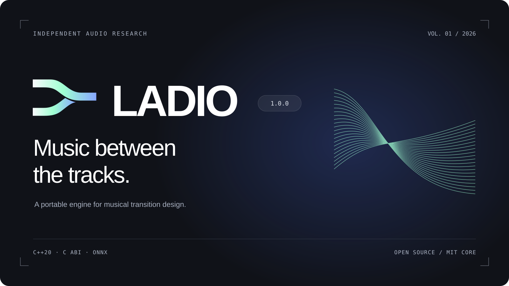
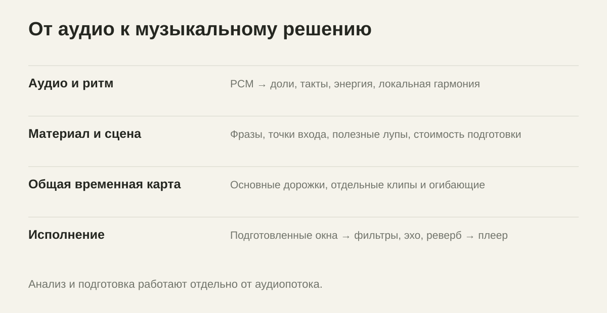
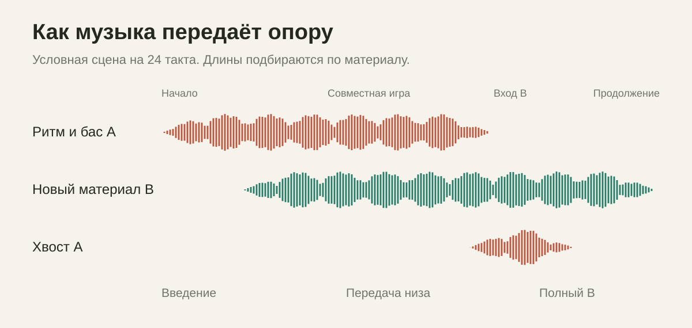
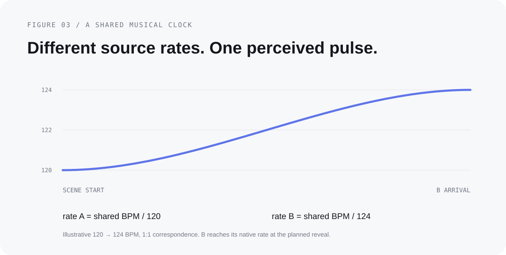

# LADIO 1.0.0

**Движок музыкальных переходов для встраивания в приложения.** C++20, C ABI, ONNX. [English](README.md) · [Визуальная работа](https://deepback.github.io/ladio/) · [Спецификация](docs/specification/ENGINE.md)

LADIO выделен из нашего AutoMix в самостоятельный репозиторий. Его задача — построить музыкальное развитие между двумя композициями: заранее представить B, удержать движение A, передать опору, раскрыть B и аккуратно завершить остатки A.

Продуктовый ориентир — AutoMix в Apple Music. Реализация независимая: приватных фреймворков, AU-пресетов и весов Apple в этой публикации нет. Совпадение звучания с Apple Music не заявляется.

## Как устроено



1. **Анализ.** Beat This small0 определяет удары и сильные доли; C++ вычисляет энергию, изменения спектра, локальную гармонию и ритмические признаки.
2. **Планирование.** Выбираются фразы, событие раскрытия B, длина совместного участка, подходящие лупы и семейство перехода. Неудачные варианты получают причины отказа.
3. **Исполнение.** Общая музыкальная шкала связывает источники, темп, независимые клипы и эффекты. Рендер и подготовленное воспроизведение используют одно ядро.

Особенность подхода — отдельные события вместо единственной точки переключения. Первое появление B, совместный грув, смена опоры, раскрытие, последний элемент A и восстановление обычного воспроизведения планируются отдельно.



В каталоге — **17 автоматических DJ-сцен и 8 дополнительных режимов непрерывности/ручного выбора**. Есть спектральная передача, фильтры, эхо, пространственный мост, повторитель, удержание грува, размытие гармонии и смена пульса. Предпочтительная длительность творческих сцен — от 2 до 18 тактов; она адаптируется к материалу. Подробности — в [каталоге](docs/specification/TRANSITIONS.md), фактические параметры — в `ladio catalog`.

## Темп, модели и ресурсы



Темп — общая карта сцены. Старый и новый источники движутся согласованно; B достигает своей скорости к запланированному раскрытию или восстановлению. Для сильно несовместимых пульсов предусмотрен музыкальный мост вместо чрезмерного растяжения всей записи.

Публичная автоматическая ветка работает со стереосигналом: **Whisper и разделитель стемов не запускаются**. Формат ресурсов умеет описывать предоставленные окна стемов, но разделять все песни на четыре источника не требуется.

В комплекте один распространяемый ONNX-анализатор — **Beat This small0 FP32**, около 9,55 МБ. Модель обучена авторами Beat This; здесь находится её экспорт и нативная интеграция. Контрольные суммы, лицензия и [карточка модели](models/beat-this-small0/MODEL_CARD.md) включены. Повторный анализ использует совпадающие сохранённые фрагменты; число потоков inference ограничено двумя. Это ограничения вычислительной стоимости, а не обещание одинакового времени на каждом телефоне.

## Собрать и встроить

В [релизе 1.0.0](https://github.com/deepback/ladio/releases/tag/v1.0.0) доступны исходники с моделью и готовые SDK ядра для macOS arm64, iOS arm64 и Android arm64. Опциональный ONNX-анализатор собирается отдельно.

```sh
git clone https://github.com/deepback/ladio.git
cd ladio
python3 scripts/verify_release.py
cmake -S . -B build -DCMAKE_BUILD_TYPE=Release
cmake --build build --config Release --parallel 2
ctest --test-dir build -C Release --output-on-failure
```

Ядро собирается без ONNX Runtime. Опциональная нейросетевая ветка включается через `LADIO_BUILD_ONNX=ON`; ей нужен SDK ONNX Runtime. Примеры C, Python, Swift и Android NDK, контракт PCM, ответственность приложения и установка через CMake описаны в [интеграции](docs/INTEGRATION.md).

```sh
python3 examples/generate_fixture.py build/demo
build/ladio prepare build/demo/library.json build/demo/mix dj 42
build/ladio render build/demo/mix/session.json build/demo/mix.wav build/demo/report.json
```

Это полностью синтетический пример с известной разметкой, который можно распространять. Он проверяет прохождение данных через движок, но не точность нейросети на коммерческих композициях.

## Открытость и границы

Исходный код LADIO, документация и графика — **MIT**, включая коммерческое встраивание. Веса Beat This сохраняют MIT-лицензию авторов. Опциональный анализатор использует отдельную библиотеку SoXR под LGPL-2.1-or-later; её исходники и уведомления включены. [Все лицензии](THIRD_PARTY_NOTICES.md).

Нейросеть может ошибаться в сетке, особенно на синкопах и неоднозначном half-time. Публичный комплект не включает модели активности инструментов, структуры или распознавания текста; эвристики не гарантируют границы каждого слова. [Проверки и ограничения](docs/VALIDATION.md) отделены от заявленных возможностей.

Оформление использует предоставленный символ LADIO и системный SF Pro с весом 760. Файлы шрифта не распространяются. Проект не связан с Apple или OpenAI.
